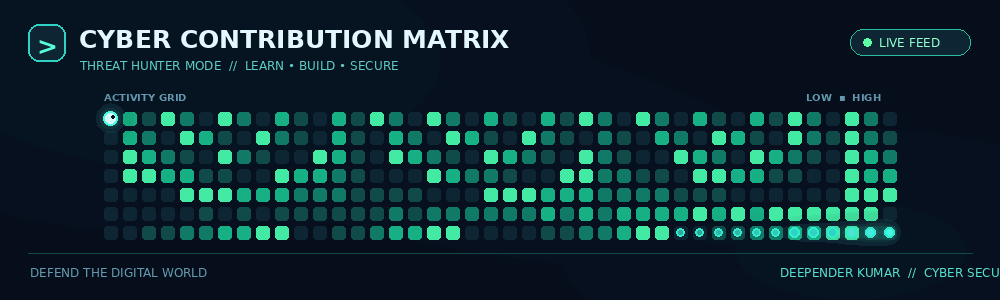

# 💫 About Me:
🎓 Final-year B.Tech Cyber Security student passionate about cybersecurity and ethical hacking.  
🔭 Working on cybersecurity projects and secure web applications.  
👯 Looking to collaborate on cybersecurity, ethical hacking, and web development projects.  
🤝 Looking for help with penetration testing, vulnerability assessment, and security best practices.  
🌱 Currently learning Ethical Hacking, Network Security, Web Application Security, and SOC fundamentals.  
💬 Ask me about HTML, CSS, Cybersecurity Fundamentals, Networking, and Web Security.  
⚡ I enjoy exploring new technologies, solving security challenges, and learning how to protect systems from cyber threats.  
🎯 My goal is to build practical cybersecurity skills and start my career in the cybersecurity industry.  
📫 Open to cybersecurity internships, entry-level opportunities, and collaborative projects.  
🎮 I enjoy movies, music, and online games.

## 🌐 Socials:
    

# 💻 Tech Stack:
                  
# 📊 GitHub Stats:
 
 

  

## 🏆 GitHub Trophies

### ✍️ Random Dev Quote

### 🔝 Top Contributed Repo

---

<!-- Proudly created with GPRM ( https://gprm.itsvg.in ) -->
